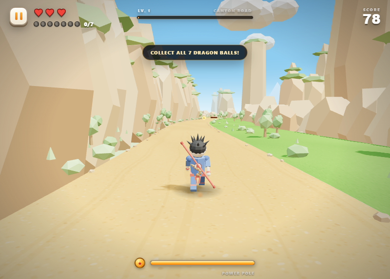

# Dragon Ball: Canyon Run

A fan-made, low-poly browser runner inspired by young Goku's canyon dash. Sprint down the canyon, leap logs and boulders, collect all seven Dragon Balls, and summon Shenron.



## Play

The game is a static site with no build step and no external assets.

- Open `index.html` directly in a modern browser, **or**
- Run `start.bat` on Windows (uses Node.js or Python if available), **or**
- Serve the folder with any static server, for example:

```bash
python -m http.server 8123 --bind 127.0.0.1
```

Then open <http://127.0.0.1:8123>.

## Controls

| Action | Keyboard | Touch |
| --- | --- | --- |
| Move | `A` / `D` or `←` / `→` | ◀ / ▶ |
| Jump | `Space`, `↑`, or `W` | `JUMP` |
| Power Pole vault | Press jump again in mid-air | Tap `JUMP` again in mid-air |
| Pause / resume | `P` or `Esc` | Pause button |
| Mute | `M` | Pause menu |

## Features

- Procedural low-poly canyon, character, props, and Dragon Balls — no image, model, or audio files.
- Endless auto-runner with lateral steering, jumping, and a mid-air Power Pole vault.
- Seven collectible Dragon Balls with respawns so the run always stays winnable.
- Three hearts, score, level progress, stamina meter, combo popups, and a comic-style Goku portrait.
- Shenron victory cinematic and a responsive win screen.
- Keyboard and touch controls, mobile HUD layout, pause/game-over/retry flow.
- Best score saved locally in `localStorage`.
- Synthesized sound effects and ambience via WebAudio.

## Tech

- Three.js r128, vendored in `vendor/three.min.js`.
- Plain HTML/CSS/JavaScript. No bundler, framework, or network requests.
- All art is generated from primitives and canvas textures at runtime.

## Debug

Append `?debug=1` to the URL to expose `window.__DBR__` for manual state inspection and testing.

## Disclaimer

This is a non-commercial fan project. Dragon Ball and related characters are trademarks of their respective owners. It is not affiliated with or endorsed by Toei Animation, Shueisha, or Bandai. No copyrighted game or anime assets are included; the code and procedural visuals in this repository are original work.
